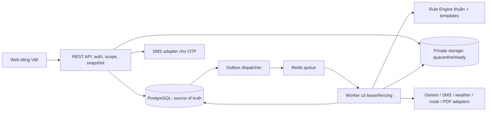

# Kiến trúc và luồng thực thi

Runtime cloud hiện hành 21/10/2026: Vercel Node Functions tại Singapore → Neon project riêng → schema `plantcare` gồm hồ sơ, session, lease/outbox và BYTEA private files. Server owner/CSRF/version guards giữ nguyên, không có filesystem tạm làm dữ liệu bền vững. Worker package Node được nạp nguyên bản và bundle bằng file tracing, `after` giữ tác vụ trong vòng đời Function. Cấu hình/giới hạn throughput và scheduler tại [VERCEL_DEPLOYMENT.md](../VERCEL_DEPLOYMENT.md), quyết định ADR-009. Phần Node-volume bên dưới là phương án lịch sử vẫn được hỗ trợ; local vẫn SQLite.

Nguồn SRS: p.9-13, 33-39, 45-55, 114-115. Stack bên dưới là đề xuất phục vụ lập kế hoạch, không phải kết luận từ PDF.

## Baseline và cấu trúc repo dự kiến

TypeScript monorepo, Next.js web, NestJS REST API modular monolith, PostgreSQL, Redis/BullMQ, S3-compatible private storage. Export bằng renderer server có font tiếng Việt đã kiểm. Chọn renderer/version ở M1 sau spike PDF; không pin dependency trong tài liệu khi chưa kiểm tương thích.

```text
apps/
  web/                       # Public/member/admin/expert UI
  api/                       # REST, auth, application orchestration
  worker/                    # Durable jobs, adapters, exports, cleanup
packages/
  domain/                    # States, quantities, invariants, ports
  rule-engine/               # DSL, evaluation, feasibility, conflict, trace
  contracts/                 # DTO/schema/OpenAPI boundary, không ORM entity
  ui/                        # Components khi có reuse thực
  test-fixtures/             # DRAFT fixtures, không production rule pack
infra/                       # Local services, deploy/migration scripts
tests/                       # Integration/E2E/load, evidence theo suite
.code/                       # Tài liệu kỹ thuật hiện tại
```

Không tạo các folder source trên trong task tài liệu này. Khi bootstrap, kiểm versions/runtime chính thức, lockfile và licence; ghi ADR nếu chọn Spring Boot/MySQL hoặc stack tương đương thay baseline. Không cần microservices ở quy mô một SE/100 user staging.



## Module boundary

| Module | Sở hữu hành vi | Giới hạn |
| --- | --- | --- |
| Identity | Registration, OTP, session, reset, role, reauthentication | SMS độc lập Gemini; chưa verified không vào app |
| Cases | Draft/version, input provenance, shipment snapshot | Một cây/chậu; owner-scoped; optimistic locking |
| Assets | Presign/quarantine/normalize/read/purge, illustrations | Object private; byte validation; scope trước signed URL |
| Catalog & Rules | DSL/catalog/template versions, fixture/review/publish | Không eval; production phải approved; referenced version bất biến |
| Planning | Snapshot, engine, alternatives, selection, trace | Không AI quyết định; FAIL/STALE chặn mutation |
| Jobs & Integrations | State/lease/retry/cancel, adapters, provider calls | Job gồm PLAN/VISION/EXPORT..., không chỉ AI |
| Consent & Quota | Purpose/notice/revoke, atomic reserve, usage ledger | Recheck trước call; manual không quota AI |
| Packing & Inventory | Checklist, actual usage, completion/movement | Transaction; required checks; không âm kho |
| Sharing & Exports | Version-pinned PDF/link, bearer scope/expiry | Projection cho share; không tái dùng PDF owner có ảnh gốc |
| Support & Privacy | Assigned tickets, expert revision, data requests | Consent/scope hiện tại; purge theo policy |
| Content & Operations | CMS, metrics, audit, notifications, quality | Chỉ published công khai; operator metadata redacted |

Application phụ thuộc domain/ports; infrastructure implement ports. API và worker dùng cùng domain/schema, không import nội bộ của nhau. Module gọi application service/port, tránh xuyên ORM repository để bypass quyền/invariant.

## Luồng manual trước AI

1. Member ACTIVE lưu draft có expected version và provenance/confirmation.
2. Backend validate hard fields, dimensions/weight/box/context; thiếu -> 422 field errors; đủ để chạy nhưng rule conflict/unsupported -> NEEDS_EXPERT trong job result.
3. Trong transaction: verify input version, canonicalize snapshot, pin published catalog/rule/template/illustration versions, tính input_hash, tạo durable job + idempotency record + outbox.
4. Dispatcher enqueue có dedup job ID. Worker claim lease với fencing token, kiểm trạng thái/current version và chạy engine trên snapshot đã pin.
5. Engine: validate -> select rules -> min/max/duration/pot/mass/traits -> actions -> conflict -> fit/load/availability -> steps/trace. Không đọc thời gian hiện tại, API hay random trong evaluation; thời gian đánh giá phải nằm trong input.
6. Commit output + plan version + outbox event nếu lease vẫn hợp lệ. Snapshot cũ vẫn lưu nhưng không auto-select nếu draft đã đổi; eligibility là so sánh hash/current input phía server.
7. User chọn PASS hoặc WARN_ACK đủ acknowledgment, làm checklist, export/share version. Lỗi ngoài không mất draft.

Unknown trên trường cứng không được biến thành PASS; cost/optional values có thể unknown mà không giả 0. Không đủ dữ liệu tạo NEEDS_INPUT/NEEDS_EXPERT, không dựng bước chuyên môn tưởng tượng.

## Luồng vision và context

Assets READY + owner + consent mục đích đúng -> reserve quota/budget -> external call qua adapter -> parse/schema/semantic validation -> suggestion riêng có source/evidence -> user xác nhận. Trước **mỗi** call kiểm consent/account/cancel; trường USER confirmed được giữ nguyên. Repair tối đa 1 lần, mọi call trong reservation/deadline/retry budget.

Context adapters trả source, fetched_at, valid_from/to, coverage và giá trị nullable. Không có provider/tuyến/dữ liệu trả unknown/manual. Manual override là input mới; provider refresh không ghi đè. Gemini tool calling, nếu bật, chỉ read tools allowlist được backend kiểm tham số.

Ảnh AI là job phụ sau decision, feature flag mặc định off. Chỉ dùng mô tả step đã chốt/ảnh có consent, kiểm hình phù hợp; fallback illustration library cùng step code. Core plan không chờ job ảnh AI.

## Durable jobs và failure modes

- DB giữ trạng thái, snapshot, stage, attempt/call count, deadline, lease/fencing, output và error. Queue delivery là at-least-once; không tuyên bố exactly-once provider call.
- Outbox commit cùng mutation, dispatch retry an toàn. Worker ghi result bằng compare-and-set trạng thái/fencing; lease heartbeat, recovery worker lấy lại job hết lease.
- Provider có idempotency thì truyền request ID; nếu không có và timeout sau khi gửi, usage có thể unknown/pending reconciliation, không coi retry là miễn phí. Ghi provider request ID/cost estimate và reserve bảo thủ.
- Retry 429 theo Retry-After, timeout/5xx backoff+jitter tối đa 2 retry tự động trong deadline. 400/401/403/schema config fail không retry cùng request mù. Limit worker attempts và provider calls tránh nhân retry hai lớp.
- Cancel best-effort; check trước call và trước commit; đã gọi provider có thể bị tính usage. Không hoàn quota như thể không có call.
- Tách queue/concurrency cho vision, plan, export/cleanup để AI tắc không làm starve manual. Budget AI cạn chỉ disable AI.
- Khi draft đổi giữa processing, plan giữ snapshot cũ và STALE; không overwrite hoặc hoàn tất current case sai version.

## Transaction boundary

| Mutation | Transaction/constraint | Ngoài transaction |
| --- | --- | --- |
| OTP verify/reset | Consume challenge once + activate/reset/revoke sessions | SMS send/callback không giữ DB lock |
| Draft patch | Owner + expected_version CAS | Upload normalization |
| Job create | Snapshot + active-job uniqueness + idempotency + outbox | Enqueue/provider |
| AI reserve | Quota/budget/concurrency reservation atomic | Provider call; settlement/reconciliation retry |
| Selection/start | Revalidate hash/status/ack + single active alternative | UI navigation |
| Complete | Current version + checks + actual package validation + stock locks + completion + movements + event | Notifications/exports |
| Rule publish | Approval+fixture+refs+expected version + active pointer + audit | Không sửa plan lịch sử |
| Share create/revoke | Owner + scope/version + token hash/expiry/revoke | Token trả một lần, signed URL sau scope check |

## Deployment và observability

Dev/staging/prod dùng data/secret/quota/bucket riêng. Dev OTP fake/rule draft được gắn nhãn và cấu hình cấm production. Health liveness không gọi provider; readiness kiểm dependencies lõi và migration. Log JSON correlation_id, metrics/error redacted, audit riêng append-only.

Deploy web/API/worker tương thích schema bằng expand/contract. Canary/flag cho compare/expert/chat/AI images. Rollback binary/active rule pointer không sửa snapshot lịch sử. Có backup trước migration, restore drill và runbook: SMS outage, AI budget stop, queue lease stuck, DB/storage unavailable, leaked secret rotation, purge thất bại.

## Runtime tách đã triển khai — 18/10/2026

Người dùng chọn Vercel frontend + Node persistent backend. Next.js beforeFiles external rewrite /api/v1 tới origin HTTPS tin cậy, browser gọi cùng origin; backend giữ auth/CSRF/owner/jobs/SQLite/files. Vercel handler local fail trước DB; API private/no-store và tắt rewrite caching. Docker Node24/Linux một replica, volume /data, font tiếng Việt, stable secret env, startup + 5 giây dispatcher dùng lease/outbox cũ. Không migration serverless hoặc scale replicas với DB riêng. [Deploy](../VERCEL_DEPLOYMENT.md), ADR-004 và implementation.md có bằng chứng/giới hạn.

Flow mới plant → instructions → guide tách auto-fill khỏi USER confirmation và tách reference coaching khỏi plan eligibility/completion/inventory. Camera đọc frame để kiểm, không lưu video/transcript. REFERENCE flag không publish rules/SOP. UI gọi API theo revision; issue/resolve không làm mất checkpoint hoặc tự tăng bước.
