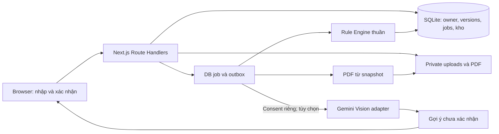

# PlantCare — AI Logistic

Website tiếng Việt giúp nhà vườn và người bán cây chuẩn bị đóng gói **một cây/chậu cho một hành trình**. Theo PRD MVP đã chốt: nhận diện/xác nhận cây → xác nhận hành trình → so sánh PA1 An toàn nhất và PA2 Tối ưu chi phí → chọn phương án → hướng dẫn từng bước bằng camera/giọng nói hoặc thủ công → hậu kiểm → lưu lịch sử. Rule Engine quyết định phương án; AI chỉ gợi ý và kiểm phần nhìn thấy.

**Trạng thái:** frontend/backend hoạt động; có cấu hình triển khai **Vercel cho giao diện + Docker Node có persistent volume**. Quy tắc/SOP vẫn DRAFT, chưa duyệt chuyên môn; release gates R0/R1 chưa nghiệm thu đầy đủ. Chưa tạo hosting production.

Repository: [vansec0812/prjAiLogistic](https://github.com/vansec0812/prjAiLogistic).

Deploy theo [VERCEL_DEPLOYMENT.md](VERCEL_DEPLOYMENT.md): backend giữ DB/ảnh/jobs trên volume, Vercel proxy API cùng origin. Cần domain backend HTTPS và SMS/Gemini thật; không chạy SQLite trên Vercel Functions.

## Mục lục

- [1. Tính năng và phạm vi](#1-tính-năng-và-phạm-vi)
- [2. Công nghệ và kiến trúc](#2-công-nghệ-và-kiến-trúc)
- [3. Cài đặt và chạy local](#3-cài-đặt-và-chạy-local)
- [4. Cấu hình môi trường](#4-cấu-hình-môi-trường)
- [5. Dùng thử một hồ sơ](#5-dùng-thử-một-hồ-sơ)
- [6. Luồng nghiệp vụ và dữ liệu](#6-luồng-nghiệp-vụ-và-dữ-liệu)
- [7. API và phân quyền](#7-api-và-phân-quyền)
- [8. Kiểm thử và build](#8-kiểm-thử-và-build)
- [9. Cấu trúc repository](#9-cấu-trúc-repository)
- [10. Nhánh Git và đóng góp](#10-nhánh-git-và-đóng-góp)
- [11. Xử lý lỗi thường gặp](#11-xử-lý-lỗi-thường-gặp)
- [12. Các phần cần hoàn thiện trước production](#12-các-phần-cần-hoàn-thiện-trước-production)
- [13. Tài liệu yêu cầu và bằng chứng](#13-tài-liệu-yêu-cầu-và-bằng-chứng)

## 1. Tính năng và phạm vi

| Nhóm | Đã triển khai trong bản local | Giới hạn hiện tại |
| --- | --- | --- |
| Tài khoản | Đăng ký pending, OTP đăng nhập/xác minh, password login/reset, hồ sơ cá nhân/shop, khóa OTP 15 phút sau 5 lần sai | OTP dev hiển thị trên UI; SMS thật chưa chọn/kiểm chứng |
| Hồ sơ | Dashboard, một ảnh/cây → xác nhận → hành trình/kênh/ngày → xác nhận; optimistic version | Một cây/chậu; chưa có tổ chức hoặc nhiều kiện |
| Flow AI | Vision v3 confidence và nguồn từng trường, NEED_INPUT nhập tay, checkbox bắt buộc; phiên pin phương án, pause/resume/end, tiếng Việt/mute/volume | Camera tùy chọn, số đo cần kiểm thực tế; không dùng ảnh suy độ chắc bên trong |
| Ảnh | JPEG/PNG/WebP, giải mã/chuẩn hóa, bỏ metadata, private owner proxy | Tối đa 10 MB/ảnh, 30 MP, 12 ảnh/hồ sơ; AI không thay đo/cân |
| Phương án | Hai BOM/bước từ danh mục quản trị; PA2 bị chặn nếu không đủ điều kiện; chi phí Decimal và unknown/null; trace/version | Seed DRAFT, giá ví dụ; ngoài scope cần chuyên gia; không là chứng nhận thùng thực đủ tải |
| Đóng gói | Bước/hình/lời đọc đúng PA1/PA2; hậu kiểm Đạt/Chưa đạt/Không chắc, kiểm tay độ cố định, complete atomic/idempotent | Không trừ kho trong MVP danh mục; nghiệp vụ kho/checklist SRS cũ giữ riêng |
| Kho và mẫu | Kho riêng, không âm stock, chỉ trừ khi hoàn tất; mẫu tạo nháp cần xác nhận lại | Chưa đầy đủ lịch sử adjustment/correction sau hoàn tất |
| Lịch sử | Snapshot/nguồn/config/selection/hậu kiểm bất biến; lọc ngày/nhóm/phương án, clone bỏ xác nhận và ngày cũ | Không tracking nhà vận chuyển thật |
| PDF và chia sẻ | PDF/Markdown/JSON/ZIP chi tiết có bill, thao tác, ảnh, nguồn và trace từ snapshot; link chỉ xem tối đa 7 ngày, thu hồi ngay | Share không gồm snapshot đầu vào, ảnh gốc hoặc PII tài khoản |
| Hỗ trợ và nội dung | Ticket mô tả/thread của owner, thông báo job, ba bài hướng dẫn chuẩn bị | Chưa chuyên gia được phân công hoặc CMS đầy đủ |
| AI/quản trị | /admin/mvp quản lý cấu hình cây/vật tư/ngưỡng/bước/hình/lời đọc; phiên bản mới → EXPERT duyệt độc lập → ADMIN reauth/kích hoạt/rollback; audit | Chưa có approval chuyên môn thật, evaluation/pilot hoặc budget tiền |

Dashboard đọc số liệu từ DB. Hồ sơ seed có nhãn mẫu phát triển; tài khoản đăng ký riêng không tự nhận seed. Không công bố chỉ số giảm hư hỏng/accuracy AI khi chưa có đánh giá thực tế.

## 2. Công nghệ và kiến trúc

Các phiên bản được pin trong `package.json` và `package-lock.json`:

| Thành phần | Công nghệ |
| --- | --- |
| Runtime | Node.js 24+; đã kiểm trên Node 24.19.0/Windows |
| Web và API | Next.js 16.4.0 App Router/Route Handlers |
| UI | React 19.3.0, TypeScript 5.9.3 strict, responsive CSS, Lucide, SVG nguyên bản |
| Validation/tính toán | Zod 4.6.6, Decimal.js 10.6.0 |
| Persistence | `node:sqlite`, WAL, foreign keys, transactions, unique constraints |
| Auth | bcryptjs 3.0.3, session cookie, OTP hash, Origin allowlist/CSRF |
| Ảnh và PDF | Sharp 0.35.5, pdf-lib 1.17.1, fontkit; font TTF hỗ trợ tiếng Việt |
| Kiểm thử | Vitest 5.0.3, Playwright 1.64.0 |



Frontend trình bày dữ liệu; server quyết định quyền/eligibility. Engine không import HTTP/DB/SDK Gemini. AI chỉ gợi ý nhận diện/giải thích nguồn; dữ liệu đã xác nhận không tự bị AI ghi đè.

Local chạy không cần Docker. Khi triển khai, người dùng chọn Vercel frontend + backend Node có volume: Docker Linux giữ SQLite/files/jobs, dispatcher khởi động và mỗi 5 giây, HTTPS proxy API trước Route Handlers. NestJS/PostgreSQL/Redis trong kế hoạch gốc là baseline đề xuất; không có migration DB tự động. Xem [.code/implementation.md](.code/implementation.md).

## 3. Cài đặt và chạy local

### Yêu cầu

- Git, **Node.js 24 trở lên**, kèm npm.
- Không cần Docker/API key/tài khoản dịch vụ ngoài để dùng luồng nhập tay.
- Cổng `3000` còn trống. E2E dùng thêm `3001`; production smoke dùng `3002`.

### Windows / PowerShell

```powershell
git clone https://github.com/vansec0812/prjAiLogistic.git
Set-Location prjAiLogistic
node --version
npm.cmd ci
npm.cmd run dev
```

### macOS / Linux

```bash
git clone https://github.com/vansec0812/prjAiLogistic.git
cd prjAiLogistic
node --version
npm ci
npm run dev
```

Mở **http://127.0.0.1:3000**. Dev server chỉ lắng nghe loopback; dừng bằng `Ctrl+C` trong terminal chạy server. Với workspace đã có tại `D:\aiLogistic`, chạy npm từ thư mục đó, không clone đè lên mã hiện có.

`npm ci` dùng lockfile để cài tái lập. Khi chủ động thay dependency, dùng `npm install` và commit cả `package.json`/`package-lock.json`.

### Build và chế độ production-gated

```powershell
npm.cmd run build
npm.cmd start
```

`start` cần build trước và dùng port 3000; dừng dev server nếu cổng đang dùng. `NODE_ENV=production` luôn tắt demo/OTP local, kể cả `PLANTCARE_MODE=development`. Engine chặn rule chưa PUBLISHED/approved; SMS thiếu cấu hình khiến tài khoản mới giữ pending. Đây là kiểm runtime production, **chưa phải go-live**. Để khám phá bản hiện tại, dùng `npm.cmd run dev`.

## 4. Cấu hình môi trường

Không cần env để chạy nhập tay theo mặc định. Nếu cần cấu hình, tạo file ở **app root**:

```powershell
Copy-Item .env.example apps/web/.env.local
```

Trên macOS/Linux: `cp .env.example apps/web/.env.local`. Sửa giá trị rồi restart. Không commit env chứa secret.

| Biến | Mặc định / ý nghĩa |
| --- | --- |
| `PLANTCARE_MODE` | Dev runtime mặc định bật sandbox; đặt `production` để tắt. `NODE_ENV=production` luôn tắt sandbox |
| `APP_ORIGIN` | Origin được phép mutation. Dev mặc định cho `http://127.0.0.1:3000`/`http://localhost:3000`; production cần cấu hình rõ |
| `PLANTCARE_DATA_DIR` | Đường dẫn tuyệt đối storage private; trống dùng `.data/` repository root |
| `GEMINI_API_KEY` | Secret server; trống thì AI không bật, nhập tay vẫn hoạt động |
| `GEMINI_VISION_MODEL` | Model ID cho Vision và RAG local adapter, cấu hình phía server, không hardcode UI |
| `AI_DAILY_CALL_LIMIT` | Trần external calls toàn app/ngày UTC, mặc định `20`; số nguyên 1–1000; chưa là budget tiền |
| `SMS_ADAPTER_URL` | HTTPS endpoint SMS adapter; chưa provider đã chọn/kiểm chứng |
| `SMS_ADAPTER_TOKEN` | Bearer token server gửi tới SMS adapter, không trả client |
| `PLANTCARE_PDF_FONT` | TTF hỗ trợ tiếng Việt; tìm Arial Windows/DejaVu Sans Linux nếu trống |

SMS adapter nhận POST JSON `{phone, code, purpose, request_id}` với purpose `REGISTER`/`LOGIN`/`RESET`. Adapter trả HTTP thành công khi chấp nhận yêu cầu; gửi được SMS không đồng nghĩa số điện thoại verified. Không log OTP/key.

`PLANTCARE_BUILD_DIR` phục vụ test riêng: E2E dùng `.next-e2e`; thông thường dùng `.next`. CLI Next.js thiết lập `NODE_ENV` theo `dev`/`build`/`start`.

## 5. Dùng thử một hồ sơ

1. Đăng ký/xác minh hoặc đăng nhập OTP/mật khẩu. Development có tài khoản mẫu, production cần SMS thật.
2. Tạo hồ sơ → chọn một ảnh/chụp ảnh, đồng ý lưu và nhận diện; hoặc nhập tay.
3. AI đánh giá đủ tên/nhóm, sáu số đo/khối lượng, độ dễ hư, vật liệu chậu và confidence từng trường. Ngưỡng mặc định 70%; trường thiếu/thấp phải nhập tay. Kiểm bằng thước/cân rồi tích **Tôi xác nhận thông số cây và chậu đã chính xác**. Sửa/thay ảnh bỏ xác nhận; đang quét khóa tiếp tục.
4. Nhập nơi đi/nơi đến, kênh Shopee/TikTok Shop/trực tiếp/khác, ngày giờ tương lai. Ước tính hành trình, chỉnh khoảng cách/ETA/nhiệt độ/nguồn, xác nhận. Chưa có weather provider: giả định mùa được ghi rõ, địa danh chưa nhận ra cần nhập tay.
5. Xem hai phương án và bảng BOM/chi phí. PA2 có thể bị ẩn kèm lý do. Giá thiếu hiển thị chưa có giá; không cộng thành giá 0. Chọn phương án, xem các hình/bước tương ứng.
6. Chọn **Sử dụng camera AI** hoặc **Hướng dẫn thủ công**. Camera preview tùy chọn; bấm **Bắt đầu** mới chạy hướng dẫn. Bật nhận lệnh/kiểm ảnh riêng nếu dùng. Có tạm dừng/tiếp tục/kết thúc, lặp lại, mute/âm lượng.
7. Nói “Đã xong bước này”/“Tiếp tục bước tiếp theo”; visual cần ảnh đạt hoặc kiểm tay. “Tôi đã kiểm tra trực tiếp” là xác nhận kiểm tay khi AI không quan sát được; lỗi đang thấy cần xử lý/kiểm lại. Nói “Tôi gặp lỗi”, “Nhắc lại”, “Dừng lại” khi cần.
8. Hoàn tất bước → **Hậu kiểm kiện**. Chụp/scan tùy chọn hoặc kiểm tay từng tiêu chí. Độ cố định bên trong luôn cần USER kiểm tay. Đủ tiêu chí mới **Lưu hồ sơ đã đóng gói**; lịch sử giữ snapshot/chi phí/phiên bản/hậu kiểm. Không mặc định lưu ảnh hậu kiểm hoặc camera.

Quy tắc/giá mẫu chỉ để thử flow. Production cần cấu hình được chuyên gia duyệt; không dùng REFERENCE flag vượt gate MVP. Mẫu kỹ thuật/ảnh chưa chuyên gia duyệt không được tự publish. Ma trận chi tiết: [.code/prd-mvp-20261019.md](.code/prd-mvp-20261019.md).

Kho, fit/load/checklist/PDF/ZIP/share theo SRS cũ tiếp tục đọc phiên bản legacy riêng; không đưa ảnh vật tư và tồn kho vào wizard MVP.

### Tri thức có nguồn và đầu ra mới

Mở **Tri thức có nguồn** trong menu hoặc `/app/knowledge`; chọn phạm vi cây chậu/xương rồng/container/vườn ươm rồi tra cứu. Bộ runtime có 19 nguồn/19 ghi chú, tất cả UNREVIEWED; metadata-only không cấp claim kỹ thuật. Lexical retrieval chạy local; chưa phải embeddings hoặc training trọng số. Video chưa đọc transcript/frame và bài chỉ có abstract/metadata không cấp claim cho retrieval. Xem [research/README.md](research/README.md).

**Hỏi AI với nguồn** cần cấu hình Gemini + consent AI_KNOWLEDGE riêng. Job pin context/version, có quota/timeout/citation/schema check; câu trả lời chỉ tham khảo, không sửa số đo, rule, checklist hoặc kho. Smoke Gemini thật đã kiểm schema/context RAG; chưa đánh giá chất lượng/chuyên môn. Không nhập thông tin cá nhân vào câu hỏi.

Trang xem lại chỉ rõ dữ liệu còn thiếu; giá unknown vẫn hợp lệ. Lưu dữ liệu không đổi giữ phương án đã chọn. Report thêm assumptions, bill/thành tiền, thao tác/điểm kiểm/điểm dừng, handover/recipient checks và sources. Ảnh photorealistic là cây mẫu trầu bà cho FOLIAGE, không là ảnh kiện thật. SVG giữ cho nhóm khác và làm fallback. ZIP chứa asset tương đối để xem offline; Markdown riêng dùng đường dẫn asset website.

## 6. Luồng nghiệp vụ và dữ liệu

Flow MVP dùng bundle bất biến gồm hai alternatives, selection pin alternative/config, guidance pin bước/lời đọc và postcheck pin cùng selection. Dữ liệu thiếu → NEED_INPUT; ngoài phạm vi/chưa duyệt → NEEDS_EXPERT; input đổi → STALE. Mỗi PATCH/control/postcheck kiểm revision phía server. Chi tiết schema mới tại [.code/prd-mvp-20261019.md](.code/prd-mvp-20261019.md).

Các trạng thái/checklist/stock bên dưới mô tả engine SRS legacy còn được bảo toàn:

| Trạng thái | Cách xử lý |
| --- | --- |
| `PASS` | Vượt kiểm bộ rule đã pin |
| `WARN_ACK` | Phải acknowledge đúng warning code/version |
| `FAIL` | Không vượt kiểm fit/load/vật tư; không chọn/hoàn tất |
| `NEEDS_INPUT` | Bổ sung dữ liệu/xác nhận/vật tư rồi tạo lại |
| `NEEDS_EXPERT` | Nhóm/rủi ro/bối cảnh hoặc rule approval ngoài phạm vi |
| `STALE` | Input hash hiện tại khác snapshot; bản cũ chỉ xem/xuất |

Giá/khối lượng/kích thước unknown là `null`, không tự thành 0. Decimal.js tính tiền/tải trọng. Giá thiếu hiện phần đã biết và mức `PARTIAL`/`UNKNOWN`; chi phí vật tư không gồm cước.

- Draft dùng `expected_version`; conflict `409`, không ghi đè âm thầm.
- Plan pin snapshot/hash/rule/template; trigger DB chặn UPDATE version.
- Job/export/complete dùng `Idempotency-Key` theo owner + endpoint; cùng key/body replay kết quả, khác body trả `409`.
- Generate không trừ kho. Completion kiểm toàn bộ stock trước transaction; thiếu một vật tư không trừ phần còn lại.
- `PACKED`/`SHIPPED`/`RECEIVED` không sửa input/chọn lại/generate mới. Dùng mẫu tạo **nháp mới** cho lượt đóng gói tiếp; retry completion cũ trả cùng kết quả.
- Checklist gắn đúng version, chỉ step ID thuộc phương án được nhận.
- Timestamp UTC; UI `Asia/Ho_Chi_Minh`; input decimal hỗ trợ dấu chấm/phẩy.

### Storage và job

`.data/` chứa SQLite/WAL, OTP secret, uploads chuẩn hóa và PDF; dữ liệu tồn tại sau restart. Storage, env, build cache và QA artifacts bị Git bỏ qua. Không đưa `.data` vào `public` hoặc static hosting.

Job lưu status/lease/attempt/outbox trong DB, chạy trong process ứng dụng. Backend Docker có dispatcher startup + mỗi 5 giây để phục hồi QUEUED/RUNNING hết lease cả khi không polling. Local vẫn đánh thức từ request. Chưa có worker Redis độc lập/SLA liên tục. Cancel best-effort; không giữ transaction xuyên external call.

Nếu sao lưu local, dừng server trước khi sao chép **toàn bộ storage directory**, giữ DB/private files/OTP secret cùng một snapshot. Chưa có automated backup/retention/restore drill production.

## 7. API và phân quyền

Flow MVP dùng `/mvp/config`, `/mvp/journey`, `/cases/:id/mvp/*`, guidance mode MVP và `/admin/mvp`. Contract/revision/ownership tại [.code/api-contracts.md](.code/api-contracts.md). `npm run test:e2e:mvp` kiểm riêng luồng mới.

Tài khoản ADMIN/EXPERT do người vận hành backend cấp cho **tài khoản đã xác minh**, không có nút tự nâng quyền trong website. Ví dụ lệnh do operator chạy trên máy giữ volume (không chạy nếu chưa xác định đúng tài khoản):

```powershell
node scripts/set-role.mjs --username ten_quan_tri --role ADMIN --data-dir D:\duong-dan-volume
node scripts/set-role.mjs --username ten_chuyen_gia --role EXPERT --data-dir D:\duong-dan-volume
```

Lệnh có audit, thu hồi phiên cũ và bảo vệ ADMIN cuối. Người dùng đăng nhập lại; quản trị mở `/admin/mvp`, tạo bản nháp; EXPERT khác tác giả duyệt; ADMIN nhập lại mật khẩu để kích hoạt hoặc quay lại bản đã duyệt. Task này không tự cấp quyền hay duyệt dữ liệu production.


Base path: `/api/v1`. Thành công: `{data, meta}`; lỗi: `{error: {code, message, field_errors?}, request_id}`. Private response no-store.

| Endpoint chính | Chức năng |
| --- | --- |
| `GET /health`, `GET /session` | Health/config availability và phiên |
| `POST /auth/register`, `/auth/login`, `/auth/logout` | Tài khoản/phiên |
| `POST /auth/otp/verify`, `/auth/otp/send` | OTP REGISTER/gửi lại |
| `POST /auth/password/reset/request`, `/auth/password/reset/confirm` | Reset và thu hồi phiên cũ |
| `GET/POST /cases`, `GET/PATCH/DELETE /cases/:id` | List/tạo/sửa/ẩn hồ sơ owner |
| `POST /cases/:id/plans`, `GET /jobs/:id` | Enqueue/stage/result |
| `GET /cases/:id/versions`, `POST /cases/:id/selection` | Snapshot history/chọn phương án |
| `GET/PATCH /cases/:id/checklist`, `POST /cases/:id/complete` | Tiến độ/completion |
| `POST /uploads`, `GET/DELETE /uploads/:id` | Multipart ảnh/private proxy; upload cần `case_id`, `purpose`, `file` |
| `GET/POST /materials`, `PATCH/DELETE /materials/:id` | Kho riêng; PATCH cần expected version |
| `GET/POST /templates`, `POST /templates/:id/clone` | Mẫu/nháp cần xác nhận lại |
| `POST /cases/:id/exports`, `GET /exports/:jobId` | Job PDF/Markdown/JSON/ZIP và download private |
| `GET/POST /cases/:id/shares`, `DELETE /shares/:id` | Tạo/list/revoke link |
| `GET /shared/:token` | Projection version chỉ xem |
| `GET/POST /consents`, `DELETE /consents/:id` | Consent/revoke |
| `/notifications`, `/tickets`, `/tickets/:id/messages`, `/me` | Thông báo/hỗ trợ/profile |
| `POST /me/data-export` | JSON owner sau reauth mật khẩu |
| `GET /admin/rules`, `/admin/jobs`, `/admin/audit`, `/admin/settings` | Read-only metadata có role gate |

Private API cần cookie HttpOnly và owner check. Mutation cần Origin hợp lệ + `x-csrf-token` từ `/session`; auth public cần Origin. Job/export/complete thêm `Idempotency-Key`. Thiếu session `401`; CSRF/role sai `403`; tài nguyên không được phép đọc `404`.

Ảnh qua authenticated proxy/no-store, không URL public filesystem. Share là bearer token ngẫu nhiên lưu hash, pin version, expiry/revoke; người nhận không sửa hồ sơ/checklist/kho. Contract mục tiêu tại [.code/api-contracts.md](.code/api-contracts.md); implementation local hẹp hơn đầy đủ SRS.

## 8. Kiểm thử và build

| Lệnh PowerShell | Nội dung |
| --- | --- |
| `npm.cmd run typecheck` | Sinh Next.js route types bằng `next typegen`, rồi TypeScript strict; chạy được ngay sau clone/cài dependencies |
| `npm.cmd run test` | 156 unit/API/regression: engine, quyền, guidance, nhận diện, voice, WAV, deploy, RAG/export |
| `npm.cmd run build` | Production compilation/TypeScript |
| `npm.cmd run check` | Typecheck + unit + build; không gồm E2E |
| `npx.cmd playwright install chromium` | Browser test trước E2E lần đầu |
| `npm.cmd run test:e2e` | 6 scenario suites API/browser của workflow đầy đủ |
| `npm.cmd run test:e2e:live` | 13 ca flow nhận diện/camera/ảnh hướng dẫn/voice/lỗi/resume, provider giả lập |
| `npm.cmd run test:proxy` | Proxy frontend/API: cookie/CSRF/body/private cache/no local DB |
| `npm.cmd run test:container` | Smoke image Docker: auth/ảnh/PDF/guidance/restart/job recovery, volume test riêng |
| `npm.cmd run test:production` | Production smoke; build trước |

macOS/Linux dùng `npm`/`npx`. E2E tự mở **3001**, cache `.next-e2e`, DB `.data/e2e/<uuid>`, tắt external AI và tự dừng. Production smoke dùng **3002**, storage riêng/tự dừng; không cần dev server 3000.

Đã kiểm OTP/reset revoke, owner/CSRF/role injection, FAIL/missing-load/STALE, optimistic conflict, checklist, stock rollback, concurrent/idempotent completion, khóa hồ sơ hoàn tất, share revoke, private/fake image, template clone, PDF thật, desktop 1440/mobile 390 và UI hoàn tất bằng số đo nhập tay.

Artifacts local: `output/qa/` screenshot/PDF, `test-results/` trace lỗi, không commit. `next-env.d.ts` và route types được Next.js sinh tự động, không commit; `typecheck` tự tạo trước khi kiểm. Đọc trace: `npx.cmd playwright show-trace <path-to-trace.zip>`. PDF QA tùy chọn sau E2E: `uv run --with pymupdf python scripts/inspect-export.py`; không dependency runtime.

Đối chiếu PRD ngày **19/10/2026**: 165 unit/API tests và 23 E2E suites qua (6 workflow, 13 camera/voice, 4 MVP); Vision v3 provider smoke thật qua với ảnh trắng và ảnh AI minh họa. Chưa đo accuracy hoặc KPI vận chuyển. Evidence chi tiết tại [.code/implementation.md](.code/implementation.md).

Bản đầu ngày **12/10/2026** qua typecheck, 18 unit test, 5 E2E suites và production build/smoke. Bản nâng cấp ngày **15/10/2026** có 31 test unit/regression (gồm 12 ca retrieval), 6 E2E suites và QA PDF 11 trang; evidence build/smoke cập nhật tại [.code/implementation.md](.code/implementation.md). Đây là evidence kỹ thuật phạm vi đã triển khai; chưa thay provider integration, chuyên môn hoặc NFR acceptance.

## 9. Cấu trúc repository

```text
prjAiLogistic/
├── apps/web/
│   ├── src/app/              Pages, route handlers, layout, CSS
│   ├── src/components/       Shell, wizard, plans, auth, screens
│   ├── src/server/           Auth, DB, API, jobs, seed, PDF/adapters
│   ├── public/illustrations/ SVG fallback và sáu bước
│   ├── public/photos/        7 ảnh AI PNG gốc/WebP và manifest
│   └── next.config.ts        Runtime/build/CSP
├── packages/
│   ├── domain/src/           Input/plan/version contracts
│   ├── rule-engine/src/      Engine thuần/fixture DRAFT/report
│   └── knowledge/src/        Corpus ngắn, scope/retrieval/citation validation
├── research/                 Review nguồn, RAG và regression dataset
├── tests/                    Unit + API/browser E2E
├── scripts/                  Sơ đồ, PDF QA, production smoke
├── .code/                    Thiết kế, ADR, backlog, traceability/evidence
├── .env.example              Placeholder, không key thật
├── AGENTS.md / agent.md      Entrypoint/quy tắc agent và SE
├── plan.md                   Lộ trình/dependency/release gates
├── PlantCare_SRS_ChiTiet_UI.pdf
├── package.json / package-lock.json
└── README.md
```

## 10. Nhánh Git và đóng góp

`main`, `develop`, `dev-sec`, `dev-nam` được khởi tạo từ cùng snapshot mã nguồn bàn giao.

| Nhánh | Vai trò |
| --- | --- |
| `main` | Mã nguồn được bàn giao; chưa đồng nghĩa đạt production release gate |
| `develop` | Tích hợp thay đổi trước khi đưa về main |
| `dev-sec` | Nhánh làm việc của sec |
| `dev-nam` | Nhánh làm việc của nam |

```bash
git fetch origin
git switch dev-sec
git merge origin/develop
# Sửa code/docs và chạy checks liên quan
git add <cac-file-da-kiem-tra>
git commit -m "feat: describe the resulting behavior"
git push origin dev-sec
```

Với nam, thay `dev-sec` bằng `dev-nam`. PR nhánh cá nhân → `develop`; sau review/checks phù hợp, tích hợp `develop` → `main`. Đây là workflow đề xuất; README không tự thiết lập branch protection hoặc CI GitHub.

Trước commit, kiểm `git status`/`git diff --cached`; không đưa storage, env/secret, node_modules, build cache/test artifacts vào Git. `.env.example` chỉ placeholder. Thay rule cần boundary tests/approval tương ứng; docs-only không cần toàn bộ browser suite.

## 11. Xử lý lỗi thường gặp

| Triệu chứng | Cách xử lý |
| --- | --- |
| PowerShell chặn `npm.ps1` | Dùng `npm.cmd`/`npx.cmd` |
| Không có `node:sqlite` | Node 24+; kiểm PATH/mở terminal mới sau cài Node |
| Port 3000/3001/3002 đã dùng | Dừng instance do bạn mở hoặc cấu hình đồng bộ; không dừng process không liên quan |
| `CSRF_ORIGIN` | Dùng loopback mặc định; nếu đổi host/port, đặt `APP_ORIGIN` đúng rồi restart |
| AI không bật | Cần cả key/model phía server + consent; vẫn nhập tay được |
| SMS thiếu khi `start` | Production không OTP bypass; dùng `dev` thử local hoặc adapter thật |
| `PDF_FONT_UNAVAILABLE` | Đặt `PLANTCARE_PDF_FONT` tới TTF có tiếng Việt rồi restart |
| Ngày mẫu đã qua | Cập nhật ngày tương lai/xác nhận rồi tạo phiên bản mới |
| STALE | Input đổi; tạo phương án mới, bản cũ còn đọc/export |
| Thiếu stock khi complete | Kiểm stock; transaction lỗi chưa trừ vật tư nào |
| `CASE_COMPLETED` | Tạo nháp từ mẫu cho lượt mới |
| Playwright thiếu browser | `npx.cmd playwright install chromium` |
| Env không được đọc | App đọc `apps/web/.env.local`, không phải `.env.local` root |

Không xóa `.data` nếu còn dữ liệu cần giữ. Issue gồm bước tái hiện, error/request ID và Node version; không đính kèm password/OTP/key/ảnh riêng tư.

## 12. Các phần cần hoàn thiện trước production

- Approval catalog/rule/template/sơ đồ chuyên môn; fixture **2 cm, 10–32 °C, 48 giờ** chưa là ngưỡng vận chuyển thực đã kiểm chứng.
- SMS/Gemini/weather/route thật, evaluation/accuracy/model regression, transient retry/schema repair và budget tiền.
- Đánh giá hai phương án/SOP MVP với chuyên gia và kiện thật; ảnh tùy biến/các nghiệp vụ expert assignment, CMS/reporting ngoài MVP tiếp tục theo SRS.
- Provenance từng field, weather validity, stock adjustment history/lượng dùng thực.
- Policy retention/purge/xóa tài khoản/đổi số/provider cleanup/backup.
- Worker độc lập, migration/scale, restore/metrics/alerts/load/performance, WCAG/cross-browser/pilot.

FR/NFR chưa nghiệm thu đầy đủ tiếp tục OPEN trong traceability. Bản local không tự bật billing/booking/tracking thật.

## 13. Tài liệu yêu cầu và bằng chứng

| Tài liệu | Mục đích |
| --- | --- |
| [Research/RAG](research/README.md) | Nguồn đã đọc, scope/license, integration/evaluation và giới hạn |
| [SRS PDF](PlantCare_SRS_ChiTiet_UI.pdf) | Nguồn yêu cầu v1.0, 116 trang |
| [agent.md](agent.md) | Invariants/quyền/workflow/Definition of Done |
| [plan.md](plan.md) | Lộ trình/milestone/dependency/release gates |
| [.code/README.md](.code/README.md) | Chỉ mục kỹ thuật |
| [.code/implementation.md](.code/implementation.md) | ADR local/evidence/giới hạn |
| [.code/traceability.md](.code/traceability.md) | 53 FR/15 NFR, UI/TC/acceptance |
| [.code/decisions.md](.code/decisions.md) | Decision OPEN/xung đột/approval |
| [.code/test-strategy.md](.code/test-strategy.md) | Test/release evidence |

Đọc `agent.md`/`.code/README.md` trước khi đổi nghiệp vụ. Cập nhật contract/ADR/evidence cùng code; không đóng FR chỉ vì đã có màn hình.


## Hướng dẫn AI theo PRD MVP

Flow và ma trận 10 tính năng: [.code/prd-mvp-20261019.md](.code/prd-mvp-20261019.md). API/phiên cũ giữ ở [GUIDED_PACKING.md](GUIDED_PACKING.md); yêu cầu đã cập nhật trong agent.md/plan.md. Quy tắc MVP production phải được EXPERT duyệt và ADMIN kích hoạt; flag REFERENCE chỉ dành phiên legacy. Deploy vẫn theo [VERCEL_DEPLOYMENT.md](VERCEL_DEPLOYMENT.md).
