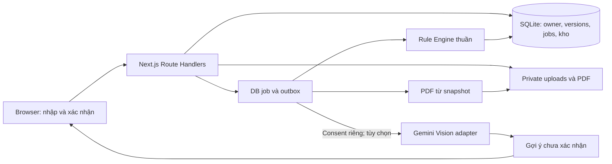

# PlantCare — AI Logistic

Website tiếng Việt giúp nhà vườn và người bán cây chuẩn bị đóng gói **một cây/chậu cho một hành trình**. Người dùng nhập hoặc tải ảnh, đo/cân thực tế, xác nhận vật tư và bối cảnh vận chuyển. Rule Engine tạo phương án có giải thích, sơ đồ từng bước và checklist; hồ sơ được lưu trên server để xem lại, xuất PDF hoặc chia sẻ phiên bản chỉ xem.

**Trạng thái:** bản local có frontend/backend hoạt động. Quy tắc và sơ đồ hiện là **DRAFT**, chưa được duyệt chuyên môn để vận chuyển cây thật. Dự án chưa đạt toàn bộ release gate R0/R1 và chưa triển khai lên hosting production.

Repository: [vansec0812/prjAiLogistic](https://github.com/vansec0812/prjAiLogistic).

## Mục lục

- [1. Tính năng và phạm vi](#1-tính-năng-và-phạm-vi)
- [2. Công nghệ và kiến trúc](#2-công-nghệ-và-kiến-trúc)
- [3. Cài đặt và chạy local](#3-cài-đặt-và-chạy-local)
- [4. Cấu hình môi trường](#4-cấu-hình-môi-trường)
- [5. Dùng thử một hồ sơ](#5-dùng-thử-một-hồ-sơ)
- [6. Luồng nghiệp vụ và dữ liệu](#6-luồng-nghiệp-vụ-và-dữ-liệu)
- [7. API và phân quyền](#7-api-và-phân-quyền)
- [8. Kiểm thử và build](#8-kiểm-thử-và-build)
- [9. Cấu trúc repository](#9-cấu-trúc-repository)
- [10. Nhánh Git và đóng góp](#10-nhánh-git-và-đóng-góp)
- [11. Xử lý lỗi thường gặp](#11-xử-lý-lỗi-thường-gặp)
- [12. Các phần cần hoàn thiện trước production](#12-các-phần-cần-hoàn-thiện-trước-production)
- [13. Tài liệu yêu cầu và bằng chứng](#13-tài-liệu-yêu-cầu-và-bằng-chứng)

## 1. Tính năng và phạm vi

| Nhóm | Đã triển khai trong bản local | Giới hạn hiện tại |
| --- | --- | --- |
| Tài khoản | Đăng ký pending, OTP một lần, đăng nhập/đăng xuất, reset mật khẩu thu hồi phiên cũ, sửa tên | OTP dev hiển thị trên UI; SMS thật chưa chọn/kiểm chứng |
| Hồ sơ | Dashboard, tạo/lưu nháp, wizard cây → vật tư → hành trình → xem lại; optimistic version | Một cây/chậu; chưa có tổ chức hoặc nhiều kiện |
| Ảnh | JPEG/PNG/WebP, giải mã/chuẩn hóa, bỏ metadata, private owner proxy | Tối đa 10 MB/ảnh, 30 MP, 12 ảnh/hồ sơ; AI không thay đo/cân |
| Phương án | Engine kiểm fit/load/vật tư, phần chi phí đã biết, rule trace và snapshot | Một phương án fixture; chưa nhiều alternatives |
| Đóng gói | Sáu bước có sơ đồ, checklist theo version, nhập số đo/cân kiện thực, completion atomic/idempotent | Rule/template/sơ đồ DRAFT; lượng dùng theo vật tư đã chọn trong phương án |
| Kho và mẫu | Kho riêng, không âm stock, chỉ trừ khi hoàn tất; mẫu tạo nháp cần xác nhận lại | Chưa đầy đủ lịch sử adjustment/correction sau hoàn tất |
| Lịch sử | Phiên bản bất biến, STALE khi input đổi, feedback, tự khai báo bàn giao/nhận | Không tracking nhà vận chuyển thật |
| PDF và chia sẻ | PDF Unicode/sơ đồ/trace từ snapshot; link chỉ xem tối đa 7 ngày, thu hồi ngay | Share không gồm snapshot đầu vào, ảnh gốc hoặc PII tài khoản |
| Hỗ trợ và nội dung | Ticket mô tả/thread của owner, thông báo job, ba bài hướng dẫn chuẩn bị | Chưa chuyên gia được phân công hoặc CMS đầy đủ |
| AI/quản trị | Vision adapter tùy chọn, consent riêng/revoke, quota số calls; admin read-only có role gate | Chưa provider integration, budget tiền, chat, ảnh AI/admin publishing |

Dashboard đọc số liệu từ DB. Hồ sơ seed có nhãn mẫu phát triển; tài khoản đăng ký riêng không tự nhận seed. Không công bố chỉ số giảm hư hỏng/accuracy AI khi chưa có đánh giá thực tế.

## 2. Công nghệ và kiến trúc

Các phiên bản được pin trong `package.json` và `package-lock.json`:

| Thành phần | Công nghệ |
| --- | --- |
| Runtime | Node.js 24+; đã kiểm trên Node 24.19.0/Windows |
| Web và API | Next.js 16.4.0 App Router/Route Handlers |
| UI | React 19.3.0, TypeScript 5.9.3 strict, responsive CSS, Lucide, SVG nguyên bản |
| Validation/tính toán | Zod 4.6.6, Decimal.js 10.6.0 |
| Persistence | `node:sqlite`, WAL, foreign keys, transactions, unique constraints |
| Auth | bcryptjs 3.0.3, session cookie, OTP hash, Origin allowlist/CSRF |
| Ảnh và PDF | Sharp 0.35.5, pdf-lib 1.17.1, fontkit; font TTF hỗ trợ tiếng Việt |
| Kiểm thử | Vitest 5.0.3, Playwright 1.64.0 |



Frontend trình bày dữ liệu; server quyết định quyền/eligibility. Engine không import HTTP/DB/SDK Gemini. AI chỉ gợi ý nhận diện; dữ liệu đã xác nhận không tự bị AI ghi đè.

SQLite/private filesystem/job trong process là lựa chọn local không cần Docker. NestJS/PostgreSQL/Redis trong kế hoạch gốc là **baseline đề xuất**; lựa chọn local không đồng nghĩa đã chốt kiến trúc production. Xem [.code/implementation.md](.code/implementation.md).

## 3. Cài đặt và chạy local

### Yêu cầu

- Git, **Node.js 24 trở lên**, kèm npm.
- Không cần Docker/API key/tài khoản dịch vụ ngoài để dùng luồng nhập tay.
- Cổng `3000` còn trống. E2E dùng thêm `3001`; production smoke dùng `3002`.

### Windows / PowerShell

```powershell
git clone https://github.com/vansec0812/prjAiLogistic.git
Set-Location prjAiLogistic
node --version
npm.cmd ci
npm.cmd run dev
```

### macOS / Linux

```bash
git clone https://github.com/vansec0812/prjAiLogistic.git
cd prjAiLogistic
node --version
npm ci
npm run dev
```

Mở **http://127.0.0.1:3000**. Dev server chỉ lắng nghe loopback; dừng bằng `Ctrl+C` trong terminal chạy server. Với workspace đã có tại `D:\aiLogistic`, chạy npm từ thư mục đó, không clone đè lên mã hiện có.

`npm ci` dùng lockfile để cài tái lập. Khi chủ động thay dependency, dùng `npm install` và commit cả `package.json`/`package-lock.json`.

### Build và chế độ production-gated

```powershell
npm.cmd run build
npm.cmd start
```

`start` cần build trước và dùng port 3000; dừng dev server nếu cổng đang dùng. `NODE_ENV=production` luôn tắt demo/OTP local, kể cả `PLANTCARE_MODE=development`. Engine chặn rule chưa PUBLISHED/approved; SMS thiếu cấu hình khiến tài khoản mới giữ pending. Đây là kiểm runtime production, **chưa phải go-live**. Để khám phá bản hiện tại, dùng `npm.cmd run dev`.

## 4. Cấu hình môi trường

Không cần env để chạy nhập tay theo mặc định. Nếu cần cấu hình, tạo file ở **app root**:

```powershell
Copy-Item .env.example apps/web/.env.local
```

Trên macOS/Linux: `cp .env.example apps/web/.env.local`. Sửa giá trị rồi restart. Không commit env chứa secret.

| Biến | Mặc định / ý nghĩa |
| --- | --- |
| `PLANTCARE_MODE` | Dev runtime mặc định bật sandbox; đặt `production` để tắt. `NODE_ENV=production` luôn tắt sandbox |
| `APP_ORIGIN` | Origin được phép mutation. Dev mặc định cho `http://127.0.0.1:3000`/`http://localhost:3000`; production cần cấu hình rõ |
| `PLANTCARE_DATA_DIR` | Đường dẫn tuyệt đối storage private; trống dùng `.data/` repository root |
| `GEMINI_API_KEY` | Secret server; trống thì AI không bật, nhập tay vẫn hoạt động |
| `GEMINI_VISION_MODEL` | Model ID được cấu hình phía server, không hardcode UI |
| `AI_DAILY_CALL_LIMIT` | Trần external calls toàn app/ngày UTC, mặc định `20`; số nguyên 1–1000; chưa là budget tiền |
| `SMS_ADAPTER_URL` | HTTPS endpoint SMS adapter; chưa provider đã chọn/kiểm chứng |
| `SMS_ADAPTER_TOKEN` | Bearer token server gửi tới SMS adapter, không trả client |
| `PLANTCARE_PDF_FONT` | TTF hỗ trợ tiếng Việt; tìm Arial Windows/DejaVu Sans Linux nếu trống |

SMS adapter nhận POST JSON `{phone, code, purpose, request_id}` với purpose `REGISTER`/`RESET`. Adapter trả HTTP thành công khi chấp nhận yêu cầu; gửi được SMS không đồng nghĩa số điện thoại verified. Không log OTP/key.

`PLANTCARE_BUILD_DIR` phục vụ test riêng: E2E dùng `.next-e2e`; thông thường dùng `.next`. CLI Next.js thiết lập `NODE_ENV` theo `dev`/`build`/`start`.

## 5. Dùng thử một hồ sơ

1. Bấm **Khám phá bản thử nghiệm local** trên trang chủ: tài khoản demo dùng chung trên máy, ba hồ sơ và kho mẫu.
2. **Tạo hồ sơ**, đặt tên; tạo hồ sơ mẫu để kiểm luồng hoặc nhập tay.
3. **Cây**: chọn nhóm, nhập chiều cao/tán/chậu/khối lượng/mức dễ hư; đo/cân trước khi xác nhận. Ảnh tùy chọn.
4. **Vật tư**: lượng dự kiến dùng, đơn giá nếu biết, khối lượng/tình trạng; hộp dùng kích thước **trong** và tải trọng có nguồn. Chọn từ kho nếu cần ghi stock khi complete.
5. **Hành trình**: nơi đi/đến, ngày gửi tương lai, thời lượng, tư thế, min/max nhiệt độ và nguồn; xác nhận bối cảnh.
6. **Xem lại → Tạo hướng dẫn**: server lưu job; UI hiện stage thực, có thể rời trang.
7. Đọc kết quả/trace: FAIL/thiếu điều kiện cần sửa input; cảnh báo acknowledgeable cần xác nhận trước checklist.
8. Xem sáu bước/sơ đồ, đánh dấu checklist, nhập số đo/cân kiện thực tế để **Xác nhận hoàn tất**.
9. Tải PDF, lưu mẫu hoặc chia sẻ version chỉ xem; thu hồi link khi cần.

Tài khoản riêng: số E.164, ví dụ `+84901234567`; username 4–30 ký tự chữ thường/số/`.`/`_`; mật khẩu 12–128 ký tự. OTP local có nhãn, không gửi SMS thật; hết hạn 5 phút, dùng một lần, tối đa 5 lần thử, gửi lại có cooldown.

Không Gemini vẫn hoàn tất luồng manual. Consent không tick sẵn; nhận diện AI, ảnh AI và chia sẻ chuyên gia là mục đích riêng. Bản ghi consent không có nghĩa mọi tính năng đó đã bật.

## 6. Luồng nghiệp vụ và dữ liệu

| Trạng thái | Cách xử lý |
| --- | --- |
| `PASS` | Vượt kiểm bộ rule đã pin |
| `WARN_ACK` | Phải acknowledge đúng warning code/version |
| `FAIL` | Không vượt kiểm fit/load/vật tư; không chọn/hoàn tất |
| `NEEDS_INPUT` | Bổ sung dữ liệu/xác nhận/vật tư rồi tạo lại |
| `NEEDS_EXPERT` | Nhóm/rủi ro/bối cảnh hoặc rule approval ngoài phạm vi |
| `STALE` | Input hash hiện tại khác snapshot; bản cũ chỉ xem/xuất |

Giá/khối lượng/kích thước unknown là `null`, không tự thành 0. Decimal.js tính tiền/tải trọng. Giá thiếu hiện phần đã biết và mức `PARTIAL`/`UNKNOWN`; chi phí vật tư không gồm cước.

- Draft dùng `expected_version`; conflict `409`, không ghi đè âm thầm.
- Plan pin snapshot/hash/rule/template; trigger DB chặn UPDATE version.
- Job/export/complete dùng `Idempotency-Key` theo owner + endpoint; cùng key/body replay kết quả, khác body trả `409`.
- Generate không trừ kho. Completion kiểm toàn bộ stock trước transaction; thiếu một vật tư không trừ phần còn lại.
- `PACKED`/`SHIPPED`/`RECEIVED` không sửa input/chọn lại/generate mới. Dùng mẫu tạo **nháp mới** cho lượt đóng gói tiếp; retry completion cũ trả cùng kết quả.
- Checklist gắn đúng version, chỉ step ID thuộc phương án được nhận.
- Timestamp UTC; UI `Asia/Ho_Chi_Minh`; input decimal hỗ trợ dấu chấm/phẩy.

### Storage và job

`.data/` chứa SQLite/WAL, OTP secret, uploads chuẩn hóa và PDF; dữ liệu tồn tại sau restart. Storage, env, build cache và QA artifacts bị Git bỏ qua. Không đưa `.data` vào `public` hoặc static hosting.

Job lưu status/lease/attempt/outbox trong DB, chạy trong process ứng dụng. Request đánh thức worker; request sau restart phục hồi QUEUED hoặc RUNNING hết lease. Chưa có worker Redis độc lập/SLA liên tục. Cancel là best-effort; không giữ transaction xuyên external call.

Nếu sao lưu local, dừng server trước khi sao chép **toàn bộ storage directory**, giữ DB/private files/OTP secret cùng một snapshot. Chưa có automated backup/retention/restore drill production.

## 7. API và phân quyền

Base path: `/api/v1`. Thành công: `{data, meta}`; lỗi: `{error: {code, message, field_errors?}, request_id}`. Private response no-store.

| Endpoint chính | Chức năng |
| --- | --- |
| `GET /health`, `GET /session` | Health/config availability và phiên |
| `POST /auth/register`, `/auth/login`, `/auth/logout` | Tài khoản/phiên |
| `POST /auth/otp/verify`, `/auth/otp/send` | OTP REGISTER/gửi lại |
| `POST /auth/password/reset/request`, `/auth/password/reset/confirm` | Reset và thu hồi phiên cũ |
| `GET/POST /cases`, `GET/PATCH/DELETE /cases/:id` | List/tạo/sửa/ẩn hồ sơ owner |
| `POST /cases/:id/plans`, `GET /jobs/:id` | Enqueue/stage/result |
| `GET /cases/:id/versions`, `POST /cases/:id/selection` | Snapshot history/chọn phương án |
| `GET/PATCH /cases/:id/checklist`, `POST /cases/:id/complete` | Tiến độ/completion |
| `POST /uploads`, `GET/DELETE /uploads/:id` | Multipart ảnh/private proxy; upload cần `case_id`, `purpose`, `file` |
| `GET/POST /materials`, `PATCH/DELETE /materials/:id` | Kho riêng; PATCH cần expected version |
| `GET/POST /templates`, `POST /templates/:id/clone` | Mẫu/nháp cần xác nhận lại |
| `POST /cases/:id/exports`, `GET /exports/:jobId` | Job PDF/download private |
| `GET/POST /cases/:id/shares`, `DELETE /shares/:id` | Tạo/list/revoke link |
| `GET /shared/:token` | Projection version chỉ xem |
| `GET/POST /consents`, `DELETE /consents/:id` | Consent/revoke |
| `/notifications`, `/tickets`, `/tickets/:id/messages`, `/me` | Thông báo/hỗ trợ/profile |
| `POST /me/data-export` | JSON owner sau reauth mật khẩu |
| `GET /admin/rules`, `/admin/jobs`, `/admin/audit`, `/admin/settings` | Read-only metadata có role gate |

Private API cần cookie HttpOnly và owner check. Mutation cần Origin hợp lệ + `x-csrf-token` từ `/session`; auth public cần Origin. Job/export/complete thêm `Idempotency-Key`. Thiếu session `401`; CSRF/role sai `403`; tài nguyên không được phép đọc `404`.

Ảnh qua authenticated proxy/no-store, không URL public filesystem. Share là bearer token ngẫu nhiên lưu hash, pin version, expiry/revoke; người nhận không sửa hồ sơ/checklist/kho. Contract mục tiêu tại [.code/api-contracts.md](.code/api-contracts.md); implementation local hẹp hơn đầy đủ SRS.

## 8. Kiểm thử và build

| Lệnh PowerShell | Nội dung |
| --- | --- |
| `npm.cmd run typecheck` | Sinh Next.js route types bằng `next typegen`, rồi TypeScript strict; chạy được ngay sau clone/cài dependencies |
| `npm.cmd run test` | 18 unit test engine |
| `npm.cmd run build` | Production compilation/TypeScript |
| `npm.cmd run check` | Typecheck + unit + build; không gồm E2E |
| `npx.cmd playwright install chromium` | Browser test trước E2E lần đầu |
| `npm.cmd run test:e2e` | 5 scenario suites API/browser |
| `npm.cmd run test:production` | Production smoke; build trước |

macOS/Linux dùng `npm`/`npx`. E2E tự mở **3001**, cache `.next-e2e`, DB `.data/e2e/<uuid>`, tắt external AI và tự dừng. Production smoke dùng **3002**, storage riêng/tự dừng; không cần dev server 3000.

Đã kiểm OTP/reset revoke, owner/CSRF/role injection, FAIL/missing-load/STALE, optimistic conflict, checklist, stock rollback, concurrent/idempotent completion, khóa hồ sơ hoàn tất, share revoke, private/fake image, template clone, PDF thật, desktop 1440/mobile 390 và UI hoàn tất bằng số đo nhập tay.

Artifacts local: `output/qa/` screenshot/PDF, `test-results/` trace lỗi, không commit. `next-env.d.ts` và route types được Next.js sinh tự động, không commit; `typecheck` tự tạo trước khi kiểm. Đọc trace: `npx.cmd playwright show-trace <path-to-trace.zip>`. PDF QA tùy chọn sau E2E: `uv run --with pymupdf python scripts/inspect-export.py`; không dependency runtime.

Typecheck, 18 unit test, 5 E2E suites, production build/smoke đã qua ở bản local bàn giao **12/10/2026**. Đây là evidence kỹ thuật phạm vi đã triển khai; chưa thay provider integration, chuyên môn hoặc NFR acceptance.

## 9. Cấu trúc repository

```text
prjAiLogistic/
├── apps/web/
│   ├── src/app/              Pages, route handlers, layout, CSS
│   ├── src/components/       Shell, wizard, plans, auth, screens
│   ├── src/server/           Auth, DB, API, jobs, seed, PDF/adapters
│   ├── public/illustrations/ SVG landing và sáu bước
│   └── next.config.ts        Runtime/build/CSP
├── packages/
│   ├── domain/src/           Input/plan/version contracts
│   └── rule-engine/src/      Engine thuần/fixture DRAFT
├── tests/                    Unit + API/browser E2E
├── scripts/                  Sơ đồ, PDF QA, production smoke
├── .code/                    Thiết kế, ADR, backlog, traceability/evidence
├── .env.example              Placeholder, không key thật
├── AGENTS.md / agent.md      Entrypoint/quy tắc agent và SE
├── plan.md                   Lộ trình/dependency/release gates
├── PlantCare_SRS_ChiTiet_UI.pdf
├── package.json / package-lock.json
└── README.md
```

## 10. Nhánh Git và đóng góp

`main`, `develop`, `dev-sec`, `dev-nam` được khởi tạo từ cùng snapshot mã nguồn bàn giao.

| Nhánh | Vai trò |
| --- | --- |
| `main` | Mã nguồn được bàn giao; chưa đồng nghĩa đạt production release gate |
| `develop` | Tích hợp thay đổi trước khi đưa về main |
| `dev-sec` | Nhánh làm việc của sec |
| `dev-nam` | Nhánh làm việc của nam |

```bash
git fetch origin
git switch dev-sec
git merge origin/develop
# Sửa code/docs và chạy checks liên quan
git add <cac-file-da-kiem-tra>
git commit -m "feat: describe the resulting behavior"
git push origin dev-sec
```

Với nam, thay `dev-sec` bằng `dev-nam`. PR nhánh cá nhân → `develop`; sau review/checks phù hợp, tích hợp `develop` → `main`. Đây là workflow đề xuất; README không tự thiết lập branch protection hoặc CI GitHub.

Trước commit, kiểm `git status`/`git diff --cached`; không đưa storage, env/secret, node_modules, build cache/test artifacts vào Git. `.env.example` chỉ placeholder. Thay rule cần boundary tests/approval tương ứng; docs-only không cần toàn bộ browser suite.

## 11. Xử lý lỗi thường gặp

| Triệu chứng | Cách xử lý |
| --- | --- |
| PowerShell chặn `npm.ps1` | Dùng `npm.cmd`/`npx.cmd` |
| Không có `node:sqlite` | Node 24+; kiểm PATH/mở terminal mới sau cài Node |
| Port 3000/3001/3002 đã dùng | Dừng instance do bạn mở hoặc cấu hình đồng bộ; không dừng process không liên quan |
| `CSRF_ORIGIN` | Dùng loopback mặc định; nếu đổi host/port, đặt `APP_ORIGIN` đúng rồi restart |
| AI không bật | Cần cả key/model phía server + consent; vẫn nhập tay được |
| SMS thiếu khi `start` | Production không OTP bypass; dùng `dev` thử local hoặc adapter thật |
| `PDF_FONT_UNAVAILABLE` | Đặt `PLANTCARE_PDF_FONT` tới TTF có tiếng Việt rồi restart |
| Ngày mẫu đã qua | Cập nhật ngày tương lai/xác nhận rồi tạo phiên bản mới |
| STALE | Input đổi; tạo phương án mới, bản cũ còn đọc/export |
| Thiếu stock khi complete | Kiểm stock; transaction lỗi chưa trừ vật tư nào |
| `CASE_COMPLETED` | Tạo nháp từ mẫu cho lượt mới |
| Playwright thiếu browser | `npx.cmd playwright install chromium` |
| Env không được đọc | App đọc `apps/web/.env.local`, không phải `.env.local` root |

Không xóa `.data` nếu còn dữ liệu cần giữ. Issue gồm bước tái hiện, error/request ID và Node version; không đính kèm password/OTP/key/ảnh riêng tư.

## 12. Các phần cần hoàn thiện trước production

- Approval catalog/rule/template/sơ đồ chuyên môn; fixture **2 cm, 10–32 °C, 48 giờ** chưa là ngưỡng vận chuyển thực đã kiểm chứng.
- SMS/Gemini/weather/route thật, evaluation/accuracy/model regression, transient retry/schema repair và budget tiền.
- Alternatives/chat/ảnh AI; expert assignment/shared scope/revision, admin publishing/CMS/reporting.
- Provenance từng field, weather validity, stock adjustment history/lượng dùng thực.
- Policy retention/purge/xóa tài khoản/đổi số/provider cleanup/backup.
- Worker độc lập, migration/scale, restore/metrics/alerts/load/performance, WCAG/cross-browser/pilot.

FR/NFR chưa nghiệm thu đầy đủ tiếp tục OPEN trong traceability. Bản local không tự bật billing/booking/tracking thật.

## 13. Tài liệu yêu cầu và bằng chứng

| Tài liệu | Mục đích |
| --- | --- |
| [SRS PDF](PlantCare_SRS_ChiTiet_UI.pdf) | Nguồn yêu cầu v1.0, 116 trang |
| [agent.md](agent.md) | Invariants/quyền/workflow/Definition of Done |
| [plan.md](plan.md) | Lộ trình/milestone/dependency/release gates |
| [.code/README.md](.code/README.md) | Chỉ mục kỹ thuật |
| [.code/implementation.md](.code/implementation.md) | ADR local/evidence/giới hạn |
| [.code/traceability.md](.code/traceability.md) | 53 FR/15 NFR, UI/TC/acceptance |
| [.code/decisions.md](.code/decisions.md) | Decision OPEN/xung đột/approval |
| [.code/test-strategy.md](.code/test-strategy.md) | Test/release evidence |

Đọc `agent.md`/`.code/README.md` trước khi đổi nghiệp vụ. Cập nhật contract/ADR/evidence cùng code; không đóng FR chỉ vì đã có màn hình.
